> **Review draft:** Claude-generated proposal preserved for review. Claims, assumptions, decisions, and implementation steps have not been independently verified or approved. The current story remains authoritative.

# BID-01 · Turn public medical supply bids into Salesforce records

**Owner** · Pending confirmation · [Execution record](#execution-record) · [NEW delivery guide](https://github.com/aispanda/Reusable-Delivery/blob/bc8d7d2816995254205002d26a4ad8a59bc1696a/new/DELIVERY.md)

**Outcome** · As a medical supply sales coordinator, I want relevant public RFQs and invitations to bid turned into Salesforce records for review so that I can identify bids worth pursuing before their deadlines.

**Demo result** · NOT RUN.

**Acceptance** · Pending. Pilot covers public solicitations, batch extraction and draft intake in a designated Salesforce test org. Bid submission, production writes and automatic opportunity creation are outside scope.

**Revision** · Design review draft, 19 November 2026. This revision makes the solution design explicit for each task, records the Cloud Storage analysis, and evaluates Gemini's candidate data model against vendor documentation. Since the previous revision there has been no Document AI batch, no Salesforce configuration and no Salesforce record write.

**Build gate** · Design comes before further build. No Salesforce metadata change, test record write or paid Document AI batch until the decisions marked *Open* in the [decision register](#decision-register) are answered and recorded here. The separately authorized one page smoke test (S-01b) is the only exception, and it writes nothing to Salesforce.

## How to read this story

| Label | Meaning |
|---|---|
| **Baseline requirement** (BR) | Owner directed constraint carried from the current story. The design must satisfy it. Changing one requires an explicit owner decision recorded in this story. |
| **Proposed criterion** | Acceptance wording drafted for sign off. Not yet accepted. |
| **Candidate design** | Recommended approach for review. Not approved and not built. |
| **Assumption** (AS) | Treated as true for planning and checked at the step named. |
| **Unknown** (UNK) | Fact not yet established. Blocks the steps listed. |
| **Decision** (DEC) | Choice that needs an owner or reviewer answer. Status is Open, Recommended or Decided. |
| **Verified (docs)** | Confirmed against vendor documentation on 19 November 2026. Not yet confirmed in this project or org. |
| **Observed** | Seen in the actual Google Cloud project or Salesforce org, with the source of the observation stated. |

Nothing in this story claims a test passed. Every check status below is NOT RUN unless evidence is attached.

## Baseline requirements

| ID | Requirement | Where the design satisfies it |
|---|---|---|
| BR-01 | **Human review.** A person decides whether to pursue each bid. The intake process never creates or updates Opportunities or Opportunity Products. | T7, T8 |
| BR-02 | **Test only Salesforce scope.** Writes go only to a designated test org. No production writes. | T6 write guard |
| BR-03 | **Source traceability.** Every stored header field and line item traces to the official notice or a page of the stored PDF, or carries a review flag. | T4, T6 |
| BR-04 | **Deduplication.** Reprocessing a known notice does not create a second intake record. | T5 |
| BR-05 | **Amendments.** Changes to a known notice are kept as history and shown to the reviewer. | T5, T7 |
| BR-06 | **Document storage.** Original PDFs and extraction JSON stay in Google Cloud Storage. Salesforce holds reviewable bid data and links. Gemini's proposal to store PDFs as Salesforce Files is tracked as [DEC-04](#dec-04-document-storage), not adopted. | T2, T3, T6 |
| BR-07 | **Open bid qualification.** Only relevant public solicitations with a verified future deadline and current notice status enter the open bid queue. Expired samples may be kept as historical evidence and never appear in the active queue. | T1, T7 |
| BR-08 | **No assumed Product match.** Source line descriptions are kept as published. A Product link is optional and reviewer confirmed. | T4, T6 |
| BR-09 | **No assumed exclusivity.** Opportunities linked to one solicitation are not assumed to be mutually exclusive, and pipeline must not be double counted. | T8 |
| BR-10 | **No runtime identifiers or credentials in this story.** Project IDs, bucket names, processor IDs, org IDs and keys stay in restricted configuration. | Throughout; placeholders such as `<bid_bucket>` are used |

## Current state and evidence

| Item | State | Evidence | Notes |
|---|---|---|---|
| Bucket | Private bucket in the AI Spanda project | Observed (reported in the 19 November brief; not inspected by the author of this revision) | Name kept in restricted configuration. |
| Storage class | Standard | Decided by owner | Chosen for a small active pilot where objects are read often during review. |
| Location | South Carolina (`us-east1`) | Decided by owner | See free tier row. |
| Free tier eligibility | Region qualifies; account eligibility unknown | Verified (docs) for the region rule. Unknown for this billing account (UNK-02) | Google's Free Tier page lists 5 GB months of regional storage per month in `us-east1`, `us-west1` and `us-central1`, combined across those regions and calculated per billing account. It requires an active Free Trial or Paid billing account and no negotiated pricing contract. Other projects on the same billing account draw from the same allowance. |
| Public access prevention | Enabled | Observed (reported) | Reviewer access must therefore use IAM or a short lived grant (DEC-05). |
| Uniform bucket level access | Enabled | Observed (reported) | Access is managed with bucket level IAM, not object ACLs. |
| Soft delete | Disabled | Decided by owner (DEC-07) | A deleted or overwritten object cannot be recovered through soft delete. T2 compensates with write once object names. |
| Sample in bucket | One page extract of the [Erie County medical supplies invitation](https://www3.erie.gov/purchasing/sites/www3.erie.gov.purchasing/files/bids/2025-06/250124-004-medical-supplies.pdf) | Observed (reported) | Expired historical notice, not an open bid. The original has 22 pages. Only page one was staged to bound processing cost. |
| Document AI API | Appeared disabled in the console | Observed (reported) | No processor exists and no batch has run. |
| Billing | Billing read blocked because the Cloud Billing API is disabled for the calling project | Observed (reported) | Cost, credits and free tier usage are unverified. |
| Salesforce | No configuration and no records written | Observed (reported) | Target org, record type and reviewer role not confirmed. |
| Orchestration | No LangGraph workflow is in use | Observed (reported) | The pilot design does not depend on one. |
| ClickUp | Task creation pending because of a rate limit | Observed (reported) | Retry after the limit resets; not a design dependency. |

## Platform facts checked for this design

These were checked against vendor documentation for this revision. Each still needs confirmation in the actual project or org at the step named.

| # | Topic | Finding | Status | Design consequence |
|---|---|---|---|---|
| F-01 | Cloud Storage free tier | 5 GB months of regional storage per month in `us-east1`, `us-west1`, `us-central1`, combined across those regions, calculated per billing account; requires an active Free Trial or Paid billing account | Verified (docs) | South Carolina qualifies by region. Actual eligibility depends on the billing account (UNK-02). |
| F-02 | Document AI batch input and output | Batch requests read from Cloud Storage, either a folder prefix or an explicit list of files with MIME types, and write JSON `Document` output to a Cloud Storage folder. The requesting user needs read permission on the input bucket and write permission on the output bucket | Verified (docs) | T3 uses an explicit file list so every input is enumerated. |
| F-03 | Batch results per file | Output is written under the operation ID and one input may produce several JSON shards. Per input results are in `metadata.individualProcessStatuses` | Verified (docs) | T3 maps each input to its status and shards, which is how AC-02 is evidenced. |
| F-04 | Processor location versus bucket location | Processors run in the `us` or `eu` multiregional location, with limited single region support. The batch request page does not say whether the bucket location must match | Verified (docs) for locations; bucket compatibility not documented | UNK-04. The smoke test (S-01b) establishes it empirically for a `us` processor and the `us-east1` bucket. |
| F-05 | Batch page limits | Enterprise Document OCR 500 pages, Form Parser 100, Layout Parser 500, Custom Extractor 200 pages per document in batch | Verified (docs) | The 119 page hospital packet exceeds the Form Parser batch limit. It needs splitting or a different processor (DEC-06). |
| F-06 | Files per batch request | The limits page states 5,000; the batch request guide states 1,000 | Verified (docs), conflicting | Not a pilot constraint. Treat 1,000 as the ceiling if it ever matters. |
| F-07 | Document AI list prices (first tier) | Enterprise Document OCR $1.50, Layout Parser $10, Form Parser $30, Custom Extractor $30 per 1,000 pages. Document AI does not appear in the Free Tier usage table | Verified (docs) | A pilot of about 50 pages through Form Parser is roughly $1.50 at list price. A one page smoke test is about $0.03. Credits, taxes and account specific pricing are unknown (UNK-02). Assume reruns are billed again. |
| F-08 | Opportunity Products | `OpportunityLineItem` requires a `PricebookEntryId`. Creating one increments the parent Opportunity Amount | Verified (docs) | Mapping solicitation lines to Opportunity Products would force a Product match (conflicts with BR-08) and change pipeline amounts (conflicts with BR-01, BR-09). Solicitation lines get their own object. |
| F-09 | Many to many relationships | A junction object is a custom object with two master detail relationships. Deleting a master deletes its detail records. User and Lead cannot be the master in a master detail relationship. A standard object cannot be the detail side of a relationship with a custom object | Verified (docs) | A junction between a custom solicitation object and Opportunity is supported. Opportunity is not on the documented exclusion list, but this must be confirmed in the test org. Lead cannot own line items through master detail. |
| F-10 | Forecasting | Collaborative Forecasts sums Opportunities. Forecast types include opportunity splits, product families and custom split types based on custom currency fields. A third party setup guide states custom field forecasts also need Team Selling and Opportunity Splits | Verified (docs) for forecast types; prerequisites from a secondary source | Any forecast change is DEC-03 and needs org discovery (UNK-06). The pilot proves deduplication in reports, not in forecasts. |
| F-11 | Files Connect | Salesforce describes Files Connect access to external systems such as Google Drive, SharePoint or Box. Cloud Storage is not named | Verified (docs) for the named systems; Cloud Storage support not found | Do not plan on Files Connect for Cloud Storage. |
| F-12 | Salesforce file storage allocation | Salesforce allocates file storage per org by edition. Secondary sources disagree on whether a per user increment applies | Unresolved across sources | If DEC-04 ever moves PDFs into Salesforce, read Setup › Storage Usage in the org instead of computing an allowance (UNK-07). |
| F-13 | Signed URLs | V4 signed URLs expire after at most 7 days, and anyone holding an active signed URL can use it | Verified (docs) | Never store a signed URL in Salesforce. If used, generate it on demand (DEC-05). |
| F-14 | Salesforce Connect | Salesforce Connect adapters are an extra cost in Enterprise, Performance and Unlimited editions | Verified (docs) | External objects are not recommended for the pilot. |
| F-15 | SAM.gov Opportunities API | Version 2 search requires an API key; records carry `noticeId`, `solicitationNumber` and `responseDeadLine` | Verified (docs and API references) | Federal identity uses `solicitationNumber`; how `noticeId` behaves across amendments is unverified (UNK-08). |
| F-16 | Duplicate rules on custom objects | Sources disagree on native duplicate rule support for custom objects | Unresolved | The design does not rely on duplicate rules. It uses a unique External ID with upsert (T5). |

## Solution overview

```mermaid
flowchart LR
  T1["T1 Discover and qualify"] ==> T2["T2 Stage PDFs in Cloud Storage"]
  T2 ==> T3["T3 Document AI batch"]
  T3 ==> T4["T4 Normalize and attach evidence"]
  T4 ==> T5["T5 Identity, dedupe, amendments"]
  T5 ==> T6["T6 Upsert drafts in test org"]
  T6 ==> T7["T7 Human review queue"]
  T7 ==> T8["T8 Manual opportunity linking"]
  T8 ==> T9["T9 Verify and accept"]
```

### What lives where (candidate design, consistent with BR-06)

| Store | Holds | Does not hold |
|---|---|---|
| Cloud Storage, private bucket | Original PDFs, Document AI output JSON, normalized intake JSON, run manifests | Credentials |
| Salesforce test org | Solicitation header, notice versions, line items, review status and flags, opportunity links, pointers to Cloud Storage objects (object path, SHA256 hash, generation), official notice URL | PDFs or extraction JSON (unless DEC-04 changes); signed URLs |
| Restricted configuration | Project, bucket, processor and org identifiers; API keys; service identities | Bid data |

### Candidate bucket layout

| Prefix | Content | Written by |
|---|---|---|
| `raw/<source>/<solicitation_key>/<sha256>.pdf` | Original PDF exactly as downloaded | T2 |
| `docai/<run_label>/` | Document AI output; the service adds the operation ID and input index below this prefix | T3 |
| `normalized/<source>/<solicitation_key>/<sha256>.json` | Normalized intake record with field and line evidence | T4 |
| `manifests/<run_label>.json` | Discovery records, input list, operation status per input, counts, flags | T1 to T6 |

The existing one page smoke test object predates this layout. It stays as smoke test evidence and is not reused as pilot input.

## Task design

Each task lists purpose, inputs, outputs, dependencies, evidence, decisions, failure handling, acceptance checks and status. Everything in this section is **candidate design** unless labelled otherwise.

### T1 · Discover and qualify solicitations

**Covers** QA-01, AC-01, BR-07 · **Status** Designed; NOT RUN.

**Purpose.** Find relevant medical supply RFQs and invitations to bid, and decide from the official source whether each one is open, historical or unverifiable.

**Inputs.**
* Official sources: the [SAM.gov Opportunities API](https://open.gsa.gov/api/get-opportunities-public-api/) for federal notices; named state and local portals for others (list to be agreed in DEC-13).
* Relevance filters such as keywords and classification codes (DEC-13).
* Current date and time in UTC at capture.

**Processing.**
1. Query or browse the source and capture notice metadata.
2. Open the official notice page and confirm notice type, issuer, solicitation ID, response deadline and latest amendment.
3. Record the deadline as published (text), the parsed date and time, and the time zone as stated.
4. Classify as **Open** (verified future deadline with a known time zone and active status), **Historical** (expired, cancelled, awarded or closed) or **Unverifiable**.

**Outputs.** One discovery record per notice in the run manifest: source, official URL, issuer, notice type, solicitation number, source notice ID where one exists, posted date, deadline as published, parsed deadline in UTC, stated time zone, latest amendment reference, qualification class, capture timestamp and who captured it. For API sources, the raw response is saved alongside the manifest.

**Dependencies.** SAM.gov API key in restricted configuration if the API is used; agreed source list and filters (DEC-13).

**Evidence.** Official URL plus capture timestamp for every notice; raw API response where applicable.

**Decisions.** DEC-11 (missing or conflicting time zone), DEC-13 (sources and relevance).

**Failure handling.**
* Deadline missing or ambiguous: classify Unverifiable. It never enters the Open queue.
* Time zone not stated: flag *Deadline unverified* and apply DEC-11.
* Deadline on the portal differs from the PDF: flag *Deadline conflict*, classify Unverifiable until the reviewer resolves it.
* Portal unavailable: record the failed attempt and retry later. No values are carried forward from an earlier capture without a fresh check.

**Acceptance checks.** Every notice in the Open queue has a verified future deadline and active status. The Erie County sample classifies as Historical. No Unverifiable notice appears in the Open queue.

### T2 · Stage source PDFs in Cloud Storage

**Covers** BR-03, BR-06 · **Status** Bucket exists and one page smoke test object uploaded (observed, reported). Pilot staging NOT RUN.

**Purpose.** Keep an immutable copy of each source document that every downstream record can point to.

**Inputs.** PDFs downloaded from official URLs; discovery records from T1.

**Processing.**
1. Compute the SHA256 hash of each file.
2. Upload to `raw/<source>/<solicitation_key>/<sha256>.pdf` with a precondition that the object must not already exist (`ifGenerationMatch=0`), so nothing is overwritten.
3. Attach object metadata: official URL, capture timestamp, solicitation key.
4. Record object path, generation, size, hash and page count in the manifest.

**Outputs.** Staged objects and manifest entries.

**Dependencies.** Existing bucket; an uploader identity with object create permission; public access prevention remains on.

**Evidence.** Manifest entries plus object metadata.

**Decisions.** DEC-07 (soft delete off; write once naming is the compensating control).

**Failure handling.**
* Hash already present: this is a replay. Skip the upload and mark the input *Duplicate content* for T5.
* Upload fails: retry. The input is not sent to T3 until staged.
* Page count above the chosen processor's batch limit (F-05): route to splitting or another processor per DEC-06 and record the choice.

**Acceptance checks.** Every input has an object path and hash in the manifest. No object generation changes after upload. The bucket stays private.

### T3 · Extract with one Document AI batch

**Covers** QA-02, AC-02 · **Status** NOT RUN. API appeared disabled; no processor exists.

**Purpose.** Produce machine readable text, tables and layout for every staged PDF, with an explicit result or error per file.

**Inputs.** Explicit list of staged object paths with `application/pdf` MIME type; processor chosen in DEC-06 in the `us` location; output prefix `docai/<run_label>/`.

**Processing.**
1. Submit one batch request with the explicit file list.
2. Poll the long running operation until it finishes.
3. Read `metadata.individualProcessStatuses` and map each input to its status and output shards.
4. Write the operation metadata into the run manifest.

**Outputs.** One or more JSON `Document` shards per successful input; per input status in the manifest; processor type and version; pages processed.

**Dependencies.** Document AI API enabled (UNK-01); billing confirmed and spend authorized by the owner (UNK-02); processor available (UNK-03); requesting identity has read on input and write on output (F-02); `us` processor works with the `us-east1` bucket (UNK-04).

**Evidence.** Operation metadata in the manifest; listing of output objects; count of inputs against count of results plus errors.

**Decisions.** DEC-06 (processor), DEC-15 (how failed extraction appears in Salesforce).

**Failure handling.**
* One input fails: record the status message against that input. If the notice qualifies as Open, T6 still creates a header draft from T1 discovery data with *Extraction status = Failed*, so an open bid is not lost.
* Whole batch fails: write nothing to Salesforce, fix the cause, rerun. Assume the rerun is billed.
* Output sharded: T4 merges shards in page order before normalization.

**Acceptance checks.** Number of inputs equals number of results plus explicit errors. For each sample, requested items, quantities and units where stated are compared with their source pages against the expected values recorded in S-02. Missing or conflicting values are flagged.

### T4 · Normalize and attach evidence

**Covers** AC-02, BR-03, BR-08 · **Status** Designed; NOT RUN. No code written.

**Purpose.** Turn processor output into one intake record per notice where every value carries its source.

**Inputs.** Document AI shards; T1 discovery record; field map agreed in S-02a.

**Processing (candidate: a small script run by the operator; no LangGraph orchestration).**
1. Merge shards per input in page order.
2. Extract header fields and line item table rows using the field map.
3. For every value record source page, text anchor from the Document AI output, confidence where the processor provides one, and extraction method (feed, processor or manual).
4. Keep quantities and units as published. Parse a numeric quantity only when unambiguous. No unit conversion.
5. Compare header values with the T1 discovery record.
6. Raise flags: *Missing*, *Conflict*, *Low confidence*, *Unparsed row*.

**Outputs.** Normalized intake JSON with a schema version under `normalized/`; a validation report in the manifest.

**Dependencies.** Field map (S-02a); confidence threshold (DEC-10).

**Evidence.** Normalized JSON references the source object path, hash and page for each value.

**Decisions.** DEC-10 (evidence granularity and threshold), DEC-12 (Product suggestions).

**Failure handling.**
* Table spans pages or has merged cells: keep the raw row text, set *Unparsed row*.
* Quantity not numeric: keep the published text, leave the numeric quantity empty, flag it.
* Header conflict between portal and PDF: keep both values, show the portal value, flag *Conflict*.

**Acceptance checks.** Every header field and line item has page evidence or a flag. Values match the expected values recorded in S-02 or are flagged.

### T5 · Identity, deduplication and amendment detection

**Covers** QA-04, AC-04, BR-04, BR-05 · **Status** Designed; NOT RUN.

**Purpose.** Make reprocessing idempotent and make changes to a known notice visible.

**Identity keys (candidate; normalization rules are DEC-09).**
* **Solicitation key** = source code + issuer code + normalized solicitation number. Normalization trims, uppercases and collapses internal whitespace. Punctuation is kept.
* **Notice version key** = solicitation key + SHA256 of the source document. For feed only updates without a new document, the source notice ID plus its modified date.
* **Line key** = notice version key + line number as published, or ordinal position when no number is printed.

**Processing.**

| Case | Detection | Action |
|---|---|---|
| Replay | Same solicitation key and same document hash | No new records. Update *Last seen*. Log *Replay* in the manifest. |
| Amendment | Same solicitation key, new hash, or the source shows an amendment | Create a new notice version and its line items. Mark earlier lines *Superseded*. Set *Changed since review* and return the review status to *Needs review*. The reviewer's earlier pursue or no bid decision is kept, not overwritten. |
| New notice | Unknown solicitation key | Create header, version 1 and line items. |
| Same number, different issuer | Key differs by issuer | Separate records. |
| No solicitation number | Key cannot be formed | Fall back to source + hash of the official URL and flag *Weak identity* for the reviewer. |

**Salesforce mechanism.** Unique, case insensitive External ID fields on the solicitation, version and line objects; writes use upsert on those fields. Duplicate rules are not relied on (F-16).

**Dependencies.** T4 output; External ID fields deployed (S-03a).

**Evidence.** Record counts before and after each run; manifest log of replay and amendment decisions.

**Decisions.** DEC-09.

**Failure handling.**
* Unique constraint error: record the row and stop that notice; do not create a variant key.
* Concurrent runs: out of scope for the pilot (AS-06).
* Amendment arrives after a *Pursue* decision: flag only. Opportunities are never changed by intake.

**Acceptance checks.** Replaying the same notice creates zero new records. Replaying an amended or synthetic conflicting notice creates exactly one new version, marks changed lines and raises *Changed since review*.

### T6 · Salesforce intake model and draft upsert

**Covers** QA-03, AC-03, BR-02, BR-03, BR-06 · **Status** Model is candidate only (DEC-01, DEC-02). Org not inspected. NOT RUN.

**Purpose.** Give the reviewer one record per solicitation with its versions, lines, flags and source links, without touching pipeline.

**Candidate objects.** Names are working names for review.

`Bid_Solicitation__c` (one per solicitation key)

| Field | Type | Notes |
|---|---|---|
| Name | Text | Notice title |
| Solicitation_Key__c | Text, External ID, unique | T5 key |
| Source_System__c | Picklist | SAM.gov, state portal, local portal, other |
| Issuer_Name__c | Text | As published |
| Issuer_Account__c | Lookup Account, optional | Set by the reviewer, never inferred |
| Solicitation_Number__c, Source_Notice_Id__c | Text | As published |
| Notice_Type__c | Picklist | RFQ, invitation to bid, RFP, sources sought, other |
| Official_URL__c | URL | Official notice page |
| Response_Deadline__c | Date/Time | Stored in UTC |
| Deadline_As_Published__c, Deadline_Time_Zone__c | Text | Published text and IANA zone where stated |
| Qualification__c | Picklist | Open, Historical, Unverifiable |
| Notice_Status__c | Picklist | Active, amended, cancelled, awarded, closed |
| Review_Status__c | Picklist | Needs review, In review, Pursue, No bid, Historical |
| Changed_Since_Review__c, Deadline_Unverified__c, Weak_Identity__c | Checkbox | Flags |
| Extraction_Status__c | Picklist | Succeeded, Partial, Failed, Not run |
| Extraction_Issue_Count__c | Number | Open flags across lines |
| Current_Version__c | Lookup to version | Latest notice version |
| Estimated_Value_Info__c | Currency | Informational only; excluded from pipeline reports (rule R1) |
| Decision_Reason__c, Reviewer_Notes__c | Long text | Reviewer input |

`Bid_Notice_Version__c` (master detail to solicitation): Version_Key__c (External ID), amendment number as published, captured at, Source_Object_Path__c, Source_Sha256__c, Source_Generation__c, Extraction_Json_Path__c, Normalized_Json_Path__c, processor type and version, change summary from the T5 comparison, Is_Current__c.

`Bid_Line_Item__c` (master detail to solicitation, lookup to version): Line_Key__c (External ID), line number as published, Source_Description__c (required, as published), Quantity__c (number, optional), Quantity_As_Published__c, Unit_As_Published__c, Source_Page__c, Confidence__c, Needs_Review__c, Line_Status__c (Current, Superseded), Suggested_Product__c (optional Product2 lookup), Product_Match_Status__c (Not matched, Suggested, Confirmed, No equivalent).

`Bid_Opportunity_Link__c` is described in T8.

**Write path (candidate, DEC-14).** Build CSV files from the normalized JSON and upsert with the Salesforce CLI on the External ID fields, in the order solicitation, version, line items. The Headless 360 MCP connection is the alternative for very low volume. Exact CLI command and flag names are confirmed against the installed CLI version in S-01.

**Write guard.** Before any write, the loader queries the Organization record and stops unless the target is a sandbox or an org explicitly registered in restricted configuration as the designated test org (BR-02).

**Access (candidate).** A *Bid Intake Reviewer* permission set (read and edit on the bid objects, read on Opportunity, create on the link object) and a *Bid Intake Loader* permission set for the integration identity (create and edit on the bid objects only, no Opportunity access).

**Dependencies.** S-02a discovery; approved DEC-01, DEC-02, DEC-14; metadata deployed in S-03a.

**Evidence.** Upsert result files per object; record counts; the reviewer opening a record and its source PDF.

**Failure handling.**
* Partial load: rerun the idempotent upsert.
* Row validation error: log it per row in the manifest; the rest of the load continues.
* The loader never deletes records.

**Acceptance checks.** QA-03 below.

### T7 · Human review and the open bid queue

**Covers** BR-01, BR-07, AC-01, AC-03 · **Status** Designed; NOT RUN.

**Purpose.** Let a person verify extracted data against the source and decide whether to pursue.

**Queue definition.** A list view where Qualification is Open, Response Deadline is later than now, and Review Status is Needs review or In review. Historical and Unverifiable records stay searchable but never appear in this view. Expiry needs no automation because the deadline filter removes the record. An optional scheduled flow that sets Historical after the deadline is a candidate, not a requirement.

**Reviewer actions.**
1. Open the solicitation and its source PDF through the approved access method (DEC-05).
2. Check header fields and lines against the cited pages. Clear or confirm flags.
3. Set Review Status. Record a reason for No bid.
4. Optionally confirm a Product suggestion per line (DEC-12).
5. Optionally link one or more Opportunities (T8).

**Failure handling.** If the PDF cannot be opened, the reviewer records it and the record stays in *Needs review*. A record with *Changed since review* returns to the queue even after a decision.

**Acceptance checks.** Expired samples never show in the queue. An amended notice reappears with its change summary. No Opportunity is created by intake.

### T8 · Manual opportunity linking and pipeline treatment

**Covers** BR-01, BR-09, proposed AC-05 · **Status** Candidate (DEC-02, DEC-03); NOT RUN.

**Purpose.** Relate solicitations to customer Opportunities in either direction without inflating pipeline.

**Why many to many is plausible.**

| Situation | Example | Shape | Default treatment |
|---|---|---|---|
| One pursuit for the whole bid | One team bids every line | 1 solicitation : 1 opportunity | None assumed; reviewer chooses |
| Separate lots pursued separately | Gloves and wound care lots handled by different teams | 1 : many | Usually independent scopes |
| Competing pursuits of the same scope | Two channel partners quote the same lines on a single award notice | 1 : many | Usually alternatives |
| Multiple award possible | Issuer may award the same lines to several vendors | 1 : many | Not exclusive; each pursuit counts its own expected share |
| Teaming or shared scope | Prime and partner share one pursuit | 1 : many | Allocated share |
| One opportunity spans several solicitations | Annual supply agreement pursued across separate facility solicitations | many : 1 | Opportunity counted once |
| Cancelled and reissued notice | New solicitation number for the same need | many : 1 | Old link becomes informational |

The table shows typical cases only. The design does not assume any of them. Pipeline treatment is a **required choice with no default** on every link.

**Candidate link object `Bid_Opportunity_Link__c`.**

| Field | Notes |
|---|---|
| Solicitation | Master detail to `Bid_Solicitation__c` |
| Opportunity | Relationship type per DEC-02 |
| Scope | Whole solicitation, or the lots or lines covered (text plus optional line references) |
| Link_Role__c | Prime pursuit, partner or channel pursuit, teaming, related or reissued |
| Pipeline_Treatment__c | Counts fully · Counts allocated share · Alternative · Informational (required, no default) |
| Allocation_Percent__c | Required for allocated share |
| Alternative_Group__c, Is_Counted_Alternative__c | Groups competing pursuits; at most one counted per group |
| Counted_Amount__c | Calculated per the rules below |
| Linked_By__c, Linked_On__c | Audit |

**Counting rules (candidate).**
* **R1** Solicitation records carry no forecastable amount. Any estimated value is informational and excluded from pipeline reports.
* **R2** Pipeline and forecast come only from Opportunity Amount.
* **R3** Counted amount per link: full Opportunity Amount for *Counts fully*; Amount × allocation for *Counts allocated share*; full Amount only for the one counted link in an *Alternative* group and zero for the others; zero for *Informational*.
* **R4** For one Opportunity linked to several solicitations, the sum of its counted amounts across links must not exceed its Amount.
* **R5** Portfolio totals are reported from Opportunities. Link counted amounts are used only to slice pipeline by solicitation, which is where double counting would otherwise occur.
* **R6** Treatment is chosen by the reviewer when linking. Intake automation never creates, links or edits Opportunities.

**Enforcement (candidate).** Per record checks (allocation present and between 0 and 100) fit validation rules. Checks across sibling links (allocation totals, one counted alternative per group, R4) need a record triggered flow or Apex, because a validation rule cannot see other records. Which to use is decided in S-02b.

**Forecasting.** Collaborative Forecasts sums Opportunity amounts, so link rules alone do not change forecasts. If competing alternatives are also open Opportunities, forecast inflation is handled by an owner choice in DEC-03, for example forecast category on non counted alternatives, opportunity splits, or a custom forecast type. Prerequisites must be confirmed in the org (F-10, UNK-06). The pilot proves deduplication in a solicitation exposure report; forecast configuration is out of pilot scope unless the owner adds it.

**Failure handling.** Allocation above 100 percent or two counted alternatives in a group blocks the save with a message. Deleting a linked Opportunity follows DEC-02.

**Acceptance checks.** Proposed QA-05 below.

### T9 · Verify and accept

**Covers** all checks · **Status** NOT RUN.

**Purpose.** Separate the person who built the pipeline from the person who judges it.

**Inputs.** Expected values recorded in S-02 before any run; run manifests; Salesforce records; reports.

**Processing.** An independent inspector compares observed results with the expected values and each acceptance criterion, records evidence per check, and the owner records acceptance separately.

**Failure handling.** Any criterion without evidence stays NOT RUN or FAILED. Partial passes are recorded as such.

**Acceptance checks.** Check table updated with observed results and evidence links; owner acceptance recorded with date.

## Salesforce object options

Org discovery (S-02a) must come first. The comparison below uses documented platform behaviour only and invents nothing about the target org.

| Criterion | A · Lead | B · Opportunity with Opportunity Products | C · Custom solicitation objects | D · Existing org object or package | E · External objects (Salesforce Connect) |
|---|---|---|---|---|---|
| Line items without a Product | No native child lines; Lead cannot be a master detail parent (F-09) | Requires a price book entry for every line (F-08) | Yes | Unknown until S-02a | Possible, data stays outside |
| Amendment history | Field history only | Field history only | Version records | Unknown | External |
| Link to several Opportunities | Conversion produces one Opportunity per conversion | The bid itself becomes pipeline | Link object (T8) | Unknown | Lookups only |
| Pipeline effect before review | None until converted | Immediate; conflicts with BR-01 and the scope exclusion on automatic opportunity creation | None | Unknown | None |
| Reporting | Standard | Standard | Custom report types | Unknown | Limited |
| Cost | Included | Included | Uses custom object allowance | May be licensed | Extra cost in several editions (F-14) |
| Assessment | Not recommended unless the org already runs bid intake on Leads | Rejected for intake | **Candidate** | Must be checked before choosing C | Not recommended for the pilot |

**Recommendation (DEC-01, Open).** Choose C unless S-02a finds an existing object or package that already models solicitations, versions and lines. Opportunity stays the pipeline object and is linked only by reviewers.

## DEC-04 document storage

Gemini proposed storing source PDFs as Salesforce Files. That conflicts with BR-06, so it is presented here as a decision for the owner, not as a change.

| Option | Meets BR-06 | Reviewer experience | Integrity and security | Cost and effort |
|---|---|---|---|---|
| **A · Cloud Storage only (current requirement)** | Yes | Reviewer opens the PDF through DEC-05 | One authoritative copy; hash recorded in Salesforce; private bucket with public access prevention | Lowest; storage likely within free tier if the account is eligible |
| B · Salesforce Files only (Gemini) | No; requires changing BR-06 | Opens inside the record | Evidence and extraction JSON split across two systems unless JSON also moves | Consumes org file storage (F-12) |
| C · Cloud Storage canonical plus a Salesforce Files convenience copy | Yes for originals, but duplicates them | Opens inside the record | Two copies can drift; the hash must be checked on both | Moderate; consumes org file storage |
| D · Cloud Storage plus an on demand viewer that issues short lived signed URLs | Yes | One click from the record | Signed URLs never stored (F-13); needs a small service and its identity | Highest build effort |

**Recommendation.** Keep option A for the pilot. Revisit C or D only if reviewers find the access method unworkable. Any move toward B requires the owner to change BR-06 explicitly in this story.

## Decision register

| ID | Decision | Options | Recommendation | Status | Needed by |
|---|---|---|---|---|---|
| DEC-01 | Intake object | A to E above | C, subject to S-02a | Open | S-03a |
| DEC-02 | Solicitation to Opportunity relationship | Lookup on Opportunity (one solicitation per Opportunity); link object with master detail to both; link object with master detail to solicitation and lookup to Opportunity | Link object, master detail to solicitation. Choose Opportunity side (master detail, which cascades deletes, versus lookup with a chosen delete behaviour) after testing sharing and deletion behaviour in the test org | Open | S-03a |
| DEC-03 | Pipeline and forecast treatment | Report level rules only; forecast category handling; opportunity splits; custom forecast type | Rules R1 to R6 in reports for the pilot; forecast changes out of pilot scope | Open | S-03b |
| DEC-04 | Where source PDFs live | A to D above | A (current requirement) | Open, owner to confirm | S-03a |
| DEC-05 | How reviewers open the PDF | Authenticated browser access with bucket read granted to named reviewers; on demand signed URL service; Salesforce Files copy (only with DEC-04 change); official URL only | Authenticated access for named reviewers in the pilot. Official URL alone is not sufficient because portal content can change | Open; verify in S-01b | S-03 |
| DEC-06 | Document AI processor | Form Parser; Layout Parser; Enterprise Document OCR; Custom Extractor | Form Parser for the short pilot PDFs; Layout Parser or splitting for documents above 100 pages; compare output on the line item page before committing | Open; needs spend authorization | S-01b, S-03 |
| DEC-07 | Soft delete | Off; on | Owner chose off. Write once object names compensate. Revisit before any production use | Decided by owner | None |
| DEC-08 | Storage class and location | Standard in `us-east1` | As chosen | Decided by owner | None |
| DEC-09 | Identity key normalization | As in T5, or stricter rules | As in T5 | Open, reviewer to confirm | S-03a |
| DEC-10 | Evidence granularity and confidence threshold | Page level per value; text anchor; threshold value | Page per value in Salesforce, text anchors in JSON; set the threshold after reviewing the pilot's confidence distribution rather than guessing a number now | Open | S-03 |
| DEC-11 | Deadline time zone policy | Infer issuer zone; require stated zone; reviewer confirms | Use a zone only when the official notice or portal states it; otherwise flag and keep out of Open until the reviewer confirms | Open | S-02 |
| DEC-12 | Product matching | None; suggested and reviewer confirmed; automatic | Optional suggestion, reviewer confirmed; never creates Opportunity Products | Open | S-03a |
| DEC-13 | Discovery sources and relevance filters | SAM.gov; named state and local portals; filters | SAM.gov plus portals named by the owner; filters agreed with the reviewer | Open | S-02 |
| DEC-14 | Load mechanism | Salesforce CLI upsert; Headless 360 MCP | CLI upsert on External IDs for repeatability | Open | S-03 |
| DEC-15 | Failed extraction visibility | Manifest only; header draft flagged Failed | Header draft for Open notices, flagged Failed | Open | S-03 |

## Assumptions

| ID | Assumption | Checked at |
|---|---|---|
| AS-01 | The designated test org is a sandbox, scratch org or Developer Edition with API access. | S-01 |
| AS-02 | The pilot uses five or fewer documents and roughly 50 pages or fewer. | S-02 |
| AS-03 | Reviewers can sign in with Google identities that can be granted bucket read access, if DEC-05 picks authenticated access. | S-02b |
| AS-04 | The processor and the bucket are in the same Google Cloud project. | S-01 |
| AS-05 | Public notices contain no confidential data. The bucket stays private regardless. | S-02 |
| AS-06 | One operator runs the pilot; there are no concurrent runs. | S-03 |
| AS-07 | Opportunities in the test org carry Amount, so pipeline rules can be demonstrated with synthetic records. | S-02a |

## Unknowns

| ID | Unknown | Blocks |
|---|---|---|
| UNK-01 | Whether the project may enable the Document AI API (permissions and any organization policy). | S-01b, S-03 |
| UNK-02 | Billing account type, free tier eligibility, existing use of the shared free tier allowance, Document AI charges and credits. | S-01b, S-03 |
| UNK-03 | Processor availability for Form Parser and Layout Parser in `us` for this project. | S-01b |
| UNK-04 | Whether a `us` processor reads and writes the `us-east1` bucket without extra configuration (not stated in the docs). | S-01b |
| UNK-05 | Salesforce edition, existing bid or procurement objects and packages, Products and price books, record types. | S-02a |
| UNK-06 | Forecast configuration: Collaborative Forecasts, splits, forecast types. | DEC-03 |
| UNK-07 | Org file storage allocation and usage (only if DEC-04 changes). | DEC-04 |
| UNK-08 | How SAM.gov represents amendments across `noticeId` values. | T5 rules for federal notices |
| UNK-09 | Owner, reviewer role and executors for each step. | S-02b onward |

## Gemini candidate review

Gemini's suggestions were checked independently. None is adopted without a decision above.

| Gemini suggestion | Finding | Disposition |
|---|---|---|
| Separate solicitation object | Standard objects do not hold solicitation lines without Products (F-08) or keep pipeline untouched before review | Kept as candidate C, subject to S-02a (DEC-01) |
| Related line items | Supported as a master detail child | Kept, with source description required and Product optional |
| Related amendments | Supported as version records | Kept as `Bid_Notice_Version__c` |
| Link to multiple Opportunities; junction if many to many | Junction pattern is documented (F-09); many to one cases are plausible | Kept as candidate link object (DEC-02) |
| Match line items to Products | Opportunity Products require price book entries and change Opportunity Amount (F-08) | Not adopted. Optional reviewer confirmed suggestion only (DEC-12) |
| Store source files in Salesforce Files | Conflicts with BR-06; Files Connect does not list Cloud Storage (F-11); org file storage allocation unverified (F-12) | Not adopted. Recorded as DEC-04 for owner review |

## Proposed scenario checks

* **Where / who** · Authorized Google Cloud project and Salesforce test org. A sales reviewer checks the drafts. An independent inspector records results.
* **Start with** · Select three to five short public solicitation PDFs from official portals. Include a page with a line item table, an expired notice, and a known amendment or a synthetic conflict. Record expected fields from the official notice and PDFs before running the batch. Use the 119 page hospital packet only for a later stress test, after DEC-06 settles splitting or processor choice.

1. **QA-01** · Find a relevant medical supply RFQ or invitation to bid. Confirm notice type, issuer, solicitation ID, response deadline with time zone and latest amendment against the official portal. Expired or unverifiable deadlines do not qualify as open. **AC-01**
2. **QA-02** · Stage the PDFs in Cloud Storage, run one Document AI batch with an explicit file list, and confirm each input has a corresponding result or an explicit processing error in the operation metadata. Compare extracted requested items, quantities and units, where stated, against their source pages. Flag missing or conflicting values. **AC-02**
3. **QA-03** · Open the Salesforce test draft. Verify the issuing organization, solicitation ID, deadline with time zone where stated, requested items, review status, flags and source links. Verify the original PDF opens for the reviewer through the approved access method (DEC-05) and is stored in Cloud Storage, not in Salesforce. **AC-03**
4. **QA-04** · Replay the same notice and then an amended notice. Verify the original intake record is not duplicated, a new notice version is created for the amendment, and the record returns to review with *Changed since review*. Expired samples may be retained as historical test evidence and must not appear in the active sales queue. **AC-04**
5. **QA-05 (proposed new)** · With synthetic Opportunities in the test org, link one solicitation in three patterns: two independent lots, two competing alternatives, and one Opportunity linked to two solicitations. Verify the solicitation exposure report follows rules R1 to R6, and that intake created no Opportunity or Opportunity Product. **AC-05**

| Check ID | Status | Observed result and evidence |
|---|---|---|
| QA-01 | NOT RUN | Live discovery and status verification pending. |
| QA-02 | NOT RUN | No Document AI batch has run. API appeared disabled. |
| QA-03 | NOT RUN | Target object, reviewer access and DEC-05 pending. |
| QA-04 | NOT RUN | Replay and amendment fixtures pending. |
| QA-05 | NOT RUN | Proposed; depends on DEC-02 and DEC-03. |

## Acceptance criteria

| ID | Proposed criterion | Coverage | Change in this revision |
|---|---|---|---|
| AC-01 | Only relevant public solicitations with a verified future deadline and current notice status can enter the open bid queue. | QA-01 | None |
| AC-02 | The batch produces a traceable result or an explicit error for every file. Each required field or line is supported by the source or flagged for review. | QA-02 | None |
| AC-03 | Salesforce stores reviewable bid data and source links. Google Cloud Storage holds original PDFs and extraction JSON. A person decides whether to pursue the bid. | QA-03 | None. DEC-04 is open; this criterion stands unless the owner changes BR-06. |
| AC-04 | Reprocessing a notice is idempotent using source and solicitation ID. Changes to a known notice are visible to the reviewer. | QA-04 | None. T5 defines the key as source, issuer and normalized solicitation number; reviewer to confirm in DEC-09. |
| AC-05 | Linking one solicitation to several Opportunities, or one Opportunity to several solicitations, does not double count pipeline in the agreed exposure report, and the intake process creates no Opportunity or Opportunity Product. | QA-05 | **New, proposed.** Needs owner sign off. |

## Technical smoke test · 19 November 2026

* A private Standard bucket was created in the AI Spanda project in South Carolina. Public access prevention and uniform bucket level access are enabled. Soft delete is disabled at the owner's direction.
* A one page extract of the [Erie County medical supplies invitation](https://www3.erie.gov/purchasing/sites/www3.erie.gov.purchasing/files/bids/2025-06/250124-004-medical-supplies.pdf) was uploaded. This is an expired historical sample, not an open opportunity. The original is 22 pages; only page one was staged to bound processing cost. Cloud runtime identifiers remain in restricted configuration.
* Document AI processing: NOT RUN. The console showed the API disabled. Processor availability, billing and bucket compatibility are not verified.
* No Salesforce records were written.
* This one page smoke test is separate from the scenario checks and does not establish extraction quality or acceptance.

The remaining smoke test steps are in [S-01b](#s-01b-one-page-document-ai-smoke-test).

## Material blockers

**S-01 · Cloud and Salesforce access pending**
The AI Spanda project has a private Standard bucket in South Carolina. Document AI API enablement, billing eligibility and processor to bucket compatibility are unverified. A billing read was blocked because the Cloud Billing API was disabled for the calling project. Verify entitlements and permissions before enabling services or running a paid batch. The Salesforce target, record type and reviewer role remain to be confirmed.

**S-02b · Design decisions open**
DEC-01 to DEC-06 and DEC-09 to DEC-15 need answers before S-03a. DEC-04 specifically needs the owner to confirm Cloud Storage or change BR-06.

## Execution record

Route NEW, guide revision `bc8d7d2816995254205002d26a4ad8a59bc1696a`. Review draft. Cloud and Salesforce runtime identifiers belong in restricted configuration.

### Completed and observed actions

| ID | Date | Action | Evidence |
|---|---|---|---|
| E-01 | 19 Nov 2026 | Private Standard bucket created in `us-east1` in the AI Spanda project | Reported in the brief; console |
| E-02 | 19 Nov 2026 | Public access prevention and uniform bucket level access enabled; soft delete disabled by owner choice | Reported in the brief; console |
| E-03 | 19 Nov 2026 | Page one of the Erie County invitation uploaded as a historical smoke test sample | Reported in the brief; console |
| E-04 | 19 Nov 2026 | Document AI API observed disabled; no processor or batch | Reported in the brief; console |
| E-05 | 19 Nov 2026 | Billing read attempted and blocked (Cloud Billing API disabled for the calling project) | Reported in the brief |
| E-06 | 19 Nov 2026 | ClickUp task creation attempted; pending because of a rate limit | Reported in the brief |
| E-07 | 19 Nov 2026 | This design revision: platform claims checked against vendor documentation (see Files and references). No project or org access was used | This document |

### Planned steps

| Step | Action | Dependency | Executor | State |
|---|---|---|---|---|
| S-01 | Read only access probes for Salesforce (Headless 360, Salesforce CLI) and Google Cloud (project, bucket configuration readback, Document AI API state, billing linkage) | Authorized identities | Pending assignment | Pending |
| S-01b | One page Document AI smoke test, separately authorized; no Salesforce writes | S-01; owner authorization to enable the API and spend | Pending assignment | NOT RUN |
| S-02 | Select the small batch, record expected values manually, validate the checklist on a known case and a missing or conflicting case | DEC-11, DEC-13 | Pending assignment | NOT RUN |
| S-02a | Read only test org discovery; draft field mapping | S-01 | Pending assignment | NOT RUN |
| S-02b | Design review with owner and reviewer; record answers to open decisions in this story | S-02a | Pending assignment | NOT RUN |
| S-02c | Update scenario checks and acceptance criteria to the approved design | S-02b | Pending assignment | NOT RUN |
| S-03a | Build approved metadata in the test org (objects, fields, permission sets, list view, report) from source control | S-02b approval; test org confirmed | Pending assignment | NOT RUN |
| S-03 | Run the bounded batch (T1 to T7) and verify drafts, source links and replay | S-03a; authorized spend and test org writes | Pending assignment | NOT RUN |
| S-03b | Run opportunity link scenarios (T8, QA-05) with synthetic Opportunities | S-03; DEC-02, DEC-03 | Pending assignment | NOT RUN |
| S-04 | Independently inspect results against criteria; record owner acceptance separately | S-03 and S-03b evidence | Pending assignment | NOT RUN |

### Runbook

Commands use placeholders. Real identifiers come from restricted configuration and are not written back into this story. Confirm command and flag names against the installed CLI versions before use.

#### S-01 · Read only access probes

Google Cloud (read only):
1. Confirm the active account and project with `gcloud config list`. Record only that the expected identity and project are active.
2. Read the bucket configuration with `gcloud storage buckets describe gs://<bid_bucket> --format=json`. Confirm location, default storage class, public access prevention, uniform bucket level access and soft delete policy match the current state table.
3. Check Document AI API state with `gcloud services list --enabled --filter="name:documentai.googleapis.com"`. An empty result means disabled.
4. Check billing linkage in the console Billing page. Enabling the Cloud Billing API to read it from the command line is a change and needs owner authorization.

Salesforce (read only):
1. Confirm the target with `sf org display --target-org <test_alias>`.
2. Query `SELECT OrganizationType, IsSandbox FROM Organization` with `sf data query`. Stop if the target is not a sandbox or the registered test org.
3. Confirm the Headless 360 connection can read the same org.

Record each probe as Pass, Fail or Blocked with the date, in this story, without identifiers.

#### S-01b · One page Document AI smoke test

Requires owner authorization to enable the API and a stated spend ceiling.
1. Enable the API: `gcloud services enable documentai.googleapis.com`.
2. Create a Form Parser processor in the `us` location from the console processor gallery. Store its ID in restricted configuration.
3. Confirm the requesting identity can read the input object and write to `docai/smoke/`.
4. Submit a batch request with an explicit one file list pointing at the existing one page object and output `gs://<bid_bucket>/docai/smoke/`.
5. Poll the operation until it finishes. Save the operation metadata to `manifests/smoke.json`.
6. Confirm `individualProcessStatuses` has exactly one entry and list its output shards.
7. Open the output and compare a few values with page one by eye. Record what was and was not extracted.
8. Record the result for UNK-01, UNK-03 and UNK-04. Check the billed pages in the billing report when available (UNK-02).
9. Stop. No Salesforce writes.

#### S-02a · Test org discovery (read only)

1. List objects with `sf sobject list --sobject all --target-org <test_alias>` and search for names containing bid, solicitation, RFP, tender or procurement.
2. List installed packages with `sf package installed list --target-org <test_alias>`.
3. Describe Opportunity with `sf sobject describe --sobject Opportunity --target-org <test_alias>`: record types, Amount, forecast category, existing custom fields.
4. Check whether Products and a standard price book exist: `SELECT COUNT() FROM Product2` and `SELECT Id FROM Pricebook2 WHERE IsStandard = true`.
5. Read forecast settings in Setup › Forecasts Settings, or retrieve forecasting settings metadata.
6. Read Setup › Storage Usage (relevant to DEC-04).
7. Record findings against UNK-05, UNK-06, UNK-07 and AS-07, and draft the field mapping for T4 and T6.

#### S-03 · Bounded batch run (after approval)

1. T1: capture discovery records for the selected notices into `manifests/<run_label>.json`.
2. T2: hash and stage each PDF with a no overwrite precondition.
3. T3: submit one batch with the explicit file list; save operation metadata.
4. T4: merge shards, normalize, write `normalized/` JSON and the validation report.
5. T5: compute keys; classify each notice as new, replay or amendment.
6. T6: run the write guard, then upsert solicitation, version and line records.
7. T7: reviewer works the queue and records decisions.
8. Replay the same inputs and then the amended input; compare record counts before and after.
9. Update the check table with observed results and evidence links.

**Next** · Run the S-01 read only probes and S-02a org discovery, then hold the S-02b design review to answer the open decisions, starting with DEC-01, DEC-02 and DEC-04. S-01b may run in parallel once the owner authorizes enabling Document AI and the spend ceiling. It does not replace the scenario checks or authorize Salesforce writes.

## Files and references

* [Official public opportunity feed](https://open.gsa.gov/api/get-opportunities-public-api/) for U.S. federal discovery.
* [Public hospital medical supply bid PDF](https://quezoncity.gov.ph/wp-content/uploads/2025/11/54.-QCGH-26-MSLI-0093.pdf) for historical extraction and a later stress test, with no claim that bidding is open.
* [Erie County medical supplies invitation](https://www3.erie.gov/purchasing/sites/www3.erie.gov.purchasing/files/bids/2025-06/250124-004-medical-supplies.pdf), expired historical smoke test sample.
* [Document AI batch requests](https://docs.cloud.google.com/document-ai/docs/send-request#batch-processing) for Cloud Storage input and output and per document status.
* [Document AI limits](https://docs.cloud.google.com/document-ai/limits) for processor page limits.
* [Document AI regions](https://docs.cloud.google.com/document-ai/docs/regions) for processor locations.
* [Document AI pricing](https://cloud.google.com/document-ai/pricing) for page charges.
* [Google Cloud Free Tier](https://docs.cloud.google.com/free/docs/free-cloud-features) for Cloud Storage free tier regions and conditions.
* [Cloud Storage pricing](https://cloud.google.com/storage/pricing) for Standard storage rates.
* [Cloud Storage signed URLs](https://docs.cloud.google.com/storage/docs/access-control/signed-urls) for expiry limits.
* [OpportunityLineItem object reference](https://developer.salesforce.com/docs/atlas.en-us.object_reference.meta/object_reference/sforce_api_objects_opportunitylineitem.htm) for the price book entry requirement and Amount effect.
* [Relationships among objects](https://developer.salesforce.com/docs/atlas.en-us.object_reference.meta/object_reference/relationships_among_objects.htm) for master detail, junction and exclusion rules.
* [External objects](https://developer.salesforce.com/docs/atlas.en-us.object_reference.meta/object_reference/sforce_api_objects_external_objects.htm) for Salesforce Connect and Files Connect.
* [Files Connect implementation guide](https://resources.docs.salesforce.com/242/latest/en-us/sfdc/pdf/salesforce_files_connect_implementation.pdf) for supported external systems.
* [Forecasting settings metadata](https://developer.salesforce.com/docs/atlas.en-us.api_meta.meta/api_meta/meta_forecastingsettings.htm) for forecast types.
