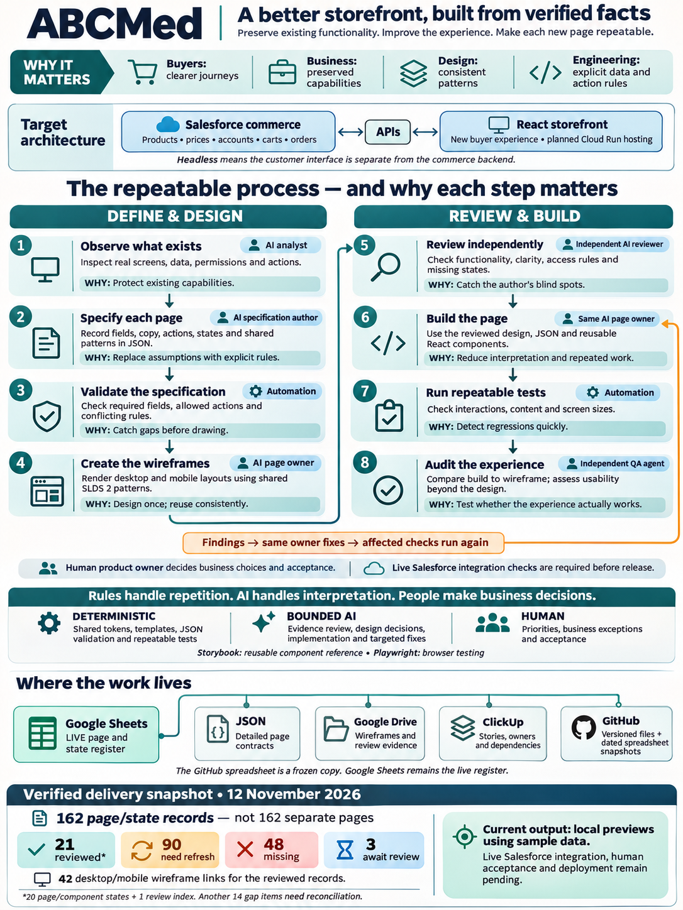

# ABCMed: a better storefront, built from verified facts

- **Purpose:** preserve existing functionality, improve the buyer experience, and make each new page repeatable.
- **Audience:** business owners, buyers, designers, engineers, and testers.
- **Dated snapshot:** 12 November 2026. This folder is explanatory reference material, not a live status dashboard.
- **Live register:** [ABCMed Headless 360 Page Register](https://docs.google.com/spreadsheets/d/1PmDfzK0RjDrr1h92JzjID6AMHUQmnHO6/edit).
- **Infographic:** [Open or download the PNG](abcmed-delivery-process.png).
- **Exact generation brief:** [prompt.txt](prompt.txt).

## What we are trying to achieve

- Build a better customer experience connected to Salesforce commerce.
- Preserve verified products, prices, account rules, carts, orders, and buyer actions.
- Improve the interface instead of copying the existing storefront's visual weaknesses.
- Reuse shared design rules and components across pages and states.
- Keep uncertainty visible: observed behavior, sample data, proposed improvements, and live verification are different things.

## Why it matters to different audiences

| Audience | Intended benefit |
|---|---|
| Buyers | Clearer journeys and understandable actions. |
| Business teams | Existing capabilities remain accounted for during modernization. |
| Designers | Consistent patterns instead of independently reinvented screens. |
| Engineers | Explicit data and action rules reduce guesswork. |
| Reviewers and testers | Traceable requirements and repeatable checks. |

- These are intended benefits, not measured claims of savings or guaranteed correctness.

## Target architecture

- **Salesforce commerce:** products, prices, accounts, carts, and orders.
- **APIs:** connect the commerce backend to the customer interface.
- **React storefront:** provides the new buyer experience.
- **Google Cloud Run:** planned hosting.
- **Headless:** the customer interface is separate from the commerce backend.
- This is the target architecture, not a claim that the complete storefront is integrated or deployed.

## The repeatable process — and why each step matters

- Each step has one executor.
- The sequence describes the delivery method; it does not mean every page has completed every step.
- AI role labels describe responsibilities, not a dependency on a particular model.

| Step | Executor | Activity | Why it matters |
|---|---|---|---|
| 1. Observe what exists | AI analyst | Inspect real screens, data, permissions, and actions. | Protect existing capabilities. |
| 2. Specify each page | AI specification author | Record fields, copy, actions, states, and shared patterns in JSON. | Replace assumptions with explicit rules. |
| 3. Validate the specification | Automation | Check required fields, allowed actions, and conflicting rules. | Catch gaps before drawing. |
| 4. Create the wireframes | AI page owner | Render desktop and mobile layouts using shared SLDS 2 patterns. | Design once; reuse consistently. |
| 5. Review independently | Independent AI reviewer | Check functionality, clarity, access rules, and missing states. | Catch the author's blind spots. |
| 6. Build the page | Same AI page owner | Use the reviewed design, JSON, and reusable React components. | Reduce interpretation and repeated work. |
| 7. Run repeatable tests | Automation | Check interactions, content, and screen sizes. | Detect regressions quickly. |
| 8. Audit the experience | Independent QA agent | Compare the build to the wireframe and assess usability beyond the design. | Test whether the experience actually works. |

### The improvement loop

- **Reviewer or test runner:** identifies a specific problem.
- **Same page owner:** fixes the affected specification, design, or implementation.
- **Automation:** reruns affected checks.
- **Independent reviewer:** verifies the revised design where applicable.
- **Independent QA agent:** verifies the corrected build.
- Shared-component changes require checking the other pages affected by that change.
- **Human product owner:** decides business choices and acceptance.
- Live Salesforce integration checks are required before release.

## The mix of rules, AI, and people

- **Deterministic work:** shared tokens, templates, JSON validation, and repeatable tests.
- **Bounded AI work:** evidence review, design decisions, implementation, and targeted fixes.
- **Human work:** priorities, business exceptions, and acceptance.
- **Storybook:** intended reusable component reference.
- **Playwright:** browser testing.
- JSON makes requirements explicit; it does not prove that business data is correct.
- A sample-data preview cannot prove live pricing, buyer access, or account isolation.

## Where the work lives

| Location | Responsibility |
|---|---|
| Google Sheets | Live page and state register; status and links. |
| JSON | Detailed page contracts: fields, copy, actions, data bindings, and state rules. |
| Google Drive | Wireframes and review evidence. |
| ClickUp | Stories, owners, and dependencies. |
| GitHub | Versioned files and dated spreadsheet snapshots. |

- The GitHub spreadsheet is a frozen copy. Google Sheets remains the live register.
- Links connect these artifacts; the infographic does not imply automatic synchronization.
- [Related spreadsheet snapshot](../ABCMed-page-register-SNAPSHOT-2026-11-12_141222_EST.xlsm).
- [Current design and build story](https://app.clickup.com/t/1k59juum0nr).
- [Outstanding verification story](https://app.clickup.com/t/1k59juum1mh).

## Verified delivery snapshot — 12 November 2026

| Wireframe status | Records |
|---|---:|
| Reviewed | 21 |
| Need refresh | 90 |
| Missing | 48 |
| Await review | 3 |
| **Total page/state records** | **162** |

- **162 records does not mean 162 separate pages.**
- The 21 reviewed records include 20 page/component states and one review-only index.
- The reviewed records have 42 linked desktop/mobile wireframes.
- Another 14 gap items require reconciliation; they are outside the original 162 records.
- Current outputs are local previews using sample data.
- Live Salesforce integration, human acceptance, and deployment remain pending.

## Content and production notes

- Content was checked against the project's delivery summary and workbook verification record.
- A separate agent reviewed the narrative for accuracy, readability, and audience fit before generation.
- The infographic was created using the built-in image-generation tool and visually checked for wording, counts, and status distinctions.
- The original PNG is preserved at its generated size of 1086 × 1448 pixels.
- This Markdown provides readable, accessible text alongside the image.

